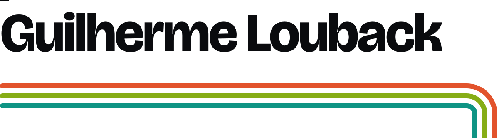
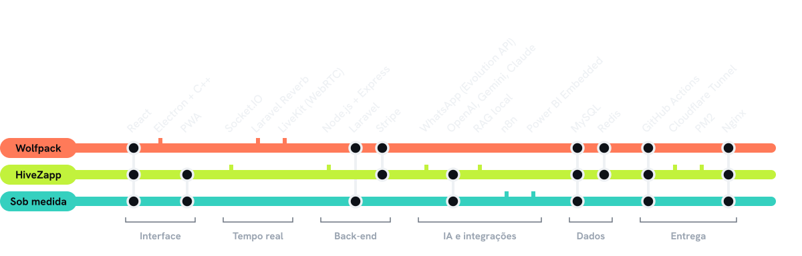
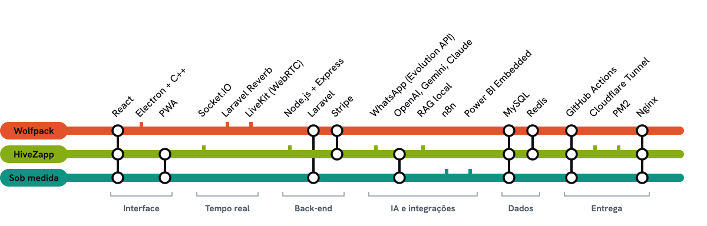
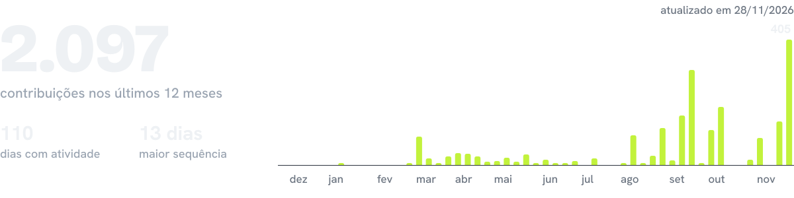
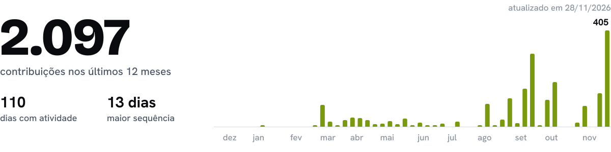

<a href="https://gloubapp.com#gh-dark-mode-only"><picture><source media="(max-width: 600px)" srcset="https://raw.githubusercontent.com/GuilhermeLouback/GuilhermeLouback/main/assets/cabecalho-escuro-celular.svg"></picture></a>
<a href="https://gloubapp.com#gh-light-mode-only"><picture><source media="(max-width: 600px)" srcset="https://raw.githubusercontent.com/GuilhermeLouback/GuilhermeLouback/main/assets/cabecalho-claro-celular.svg"></picture></a>

Sou engenheiro de software full stack e construo produtos SaaS de ponta a ponta, do banco de dados ao deploy. Meu terreno é mensageria, tempo real e automação com IA.

Hoje toco dois produtos meus, o **HiveZapp** e o **Wolfpack**, e desenvolvo sistemas sob medida que rodam em produção numa empresa de engenharia.

<a href="https://gloubapp.com"><picture><source media="(max-width: 600px)" srcset="https://raw.githubusercontent.com/GuilhermeLouback/GuilhermeLouback/main/assets/botao-site-celular.svg"></picture></a>
<a href="https://www.linkedin.com/in/guilherme-louback-45b530218/"><picture><source media="(max-width: 600px)" srcset="https://raw.githubusercontent.com/GuilhermeLouback/GuilhermeLouback/main/assets/botao-linkedin-celular.svg"></picture></a>
<a href="mailto:guilherme_lou@hotmail.com"><picture><source media="(max-width: 600px)" srcset="https://raw.githubusercontent.com/GuilhermeLouback/GuilhermeLouback/main/assets/botao-email-celular.svg"></picture></a>

## O que estou construindo

### HiveZapp

Plataforma SaaS multiempresa de atendimento e CRM no WhatsApp. Cada empresa conecta vários números, atende numa caixa de entrada compartilhada em tempo real e acompanha cada cliente num funil kanban.

- Motor de WhatsApp sobre a Evolution API, eventos em tempo real por Socket.IO e um worker separado para campanhas em massa com templates.
- Assistente de IA configurável por empresa (OpenAI, Gemini ou um endpoint compatível), com RAG local: embeddings com Transformers.js e busca vetorial no próprio SQLite, com sqlite-vec.
- Assinaturas com Stripe (webhooks, cotas e período de teste), login com Google, PWA com fila offline e permissões por papel.
- Mais de 180 rotas documentadas no Swagger, mais de 300 testes automatizados e deploy por GitHub Actions com PM2, Nginx e Cloudflare Tunnel.

**Stack:** Node.js, Express, Socket.IO, React, Vite, Tailwind CSS, MySQL e Redis.

### Wolfpack

Um Discord privado para um grupo fechado de amigos: chat, voz, câmera e transmissão de tela, no navegador e num app para Windows. Fiz do zero, do servidor de mídia ao instalador.

- Voz, vídeo e tela em até 4K a 60 fps com LiveKit (WebRTC) auto-hospedado, simulcast e supressão de ruído; chat e presença em tempo real com Laravel Reverb.
- App desktop em Electron com push-to-talk global, seletor de tela nativo com captura de áudio (módulo próprio em C++) e atualização automática pelas releases do GitHub.
- Mais de 3 mil testes automatizados (PHPUnit e Vitest), CI em todo push, deploy contínuo e release do desktop por tag. A versão atual é a [1.5.0](https://github.com/GuilhermeLouback/wolfpack-releases/releases/latest).

**Stack:** Laravel 13, React 19, TypeScript, LiveKit, Reverb, Electron, MySQL e Redis.

### Sistemas sob medida

Três sistemas web em produção para uma empresa de engenharia, que desenvolvo e mantenho de ponta a ponta:

- **Auditoria de documentos técnicos com IA.** Lê os documentos de cada inspeção, roda a auditoria com LLMs orquestrados no n8n, com saída estruturada em JSON, e gera o relatório final em PDF. Tem visualizador 3D e mapas.
- **Inteligência comercial.** Acompanha oportunidades do setor automaticamente, funciona como radar de notícias e traz um chat com IA que analisa documentos e imagens e pesquisa na web.
- **Portal de BI.** Relatórios do Power BI Embedded liberados por usuário, sem exigir licença do Power BI de quem acessa.

**Stack:** Laravel, React, TypeScript, Tailwind CSS, MySQL e n8n, com deploy por GitHub Actions em Linux (Nginx e PHP-FPM).

### Também no GitHub

- [**gloubapp**](https://github.com/GuilhermeLouback/gloubapp): o código do meu site, em Next.js 15, React 19 e Tailwind CSS 4, com uma simulação animada de código virando produto. No ar em [gloubapp.com](https://gloubapp.com).

## Mapa da stack

<a href="https://github.com/GuilhermeLouback/GuilhermeLouback/blob/main/assets/mapa-escuro.svg#gh-dark-mode-only"><picture><source media="(max-width: 1193px)" srcset="https://raw.githubusercontent.com/GuilhermeLouback/GuilhermeLouback/main/assets/mapa-escuro-celular.svg"></picture></a>
<a href="https://github.com/GuilhermeLouback/GuilhermeLouback/blob/main/assets/mapa-claro.svg#gh-light-mode-only"><picture><source media="(max-width: 1193px)" srcset="https://raw.githubusercontent.com/GuilhermeLouback/GuilhermeLouback/main/assets/mapa-claro-celular.svg"></picture></a>

Cada linha é um projeto e cada parada, uma tecnologia que uso nele. Os círculos marcam o que se repete entre projetos; os traços, o que aparece num só.

Ver a stack em texto

| Camada | Tecnologias |
| :-- | :-- |
| Interface | React, TypeScript, Vite, Tailwind CSS, Next.js, Electron, PWA, three.js |
| Tempo real | Socket.IO, Laravel Reverb, LiveKit (WebRTC) |
| Back-end | Node.js, Express, Laravel, PHP 8, Stripe |
| IA e integrações | OpenAI, Gemini, Claude, RAG com sqlite-vec, n8n, Evolution API (WhatsApp), Power BI Embedded |
| Dados | MySQL, Redis, SQLite |
| Entrega | GitHub Actions, Nginx, PHP-FPM, PM2, Cloudflare Tunnel, Linux, Vercel |

Estudando agora: Kubernetes em produção, observabilidade e MLOps.

## Como eu trabalho

- **Especifico antes de codar.** Specs, planos e diretrizes ficam versionados junto com o código.
- **Automatizo teste e entrega.** CI em todo push, deploy contínuo e release por tag.
- **Documento a API.** As rotas ficam descritas em OpenAPI, com o Swagger servido pela própria aplicação.
- **Cuido do que coloco no ar.** Runbook e scripts de backup e restauração fazem parte da entrega.

## Atividade

<a href="https://github.com/GuilhermeLouback/GuilhermeLouback/blob/output/atividade-escuro.svg#gh-dark-mode-only"><picture><source media="(max-width: 1193px)" srcset="https://raw.githubusercontent.com/GuilhermeLouback/GuilhermeLouback/output/atividade-escuro-celular.svg"></picture></a>
<a href="https://github.com/GuilhermeLouback/GuilhermeLouback/blob/output/atividade-claro.svg#gh-light-mode-only"><picture><source media="(max-width: 1193px)" srcset="https://raw.githubusercontent.com/GuilhermeLouback/GuilhermeLouback/output/atividade-claro-celular.svg"></picture></a>

Atualizado duas vezes por dia por uma [GitHub Action](https://github.com/GuilhermeLouback/GuilhermeLouback/blob/main/.github/workflows/perfil.yml) deste repositório. Quase todo o meu código fica em repositórios privados, e o gráfico conta essas contribuições também.

---

*A melhor arquitetura é aquela que escala sem que você precise estar acordado às 3 da manhã.*
